# Software Requirements Specification (SRS)
## RestaurantOps AI — AI-Powered Restaurant Inventory and Procurement Management System

---

**Project Name:** RestaurantOps AI  
**Document Title:** Software Requirements Specification (SRS)  
**Document Version:** 1.0  
**Prepared By:** Yohannes Zewde  
**Document Status:** Reconstructed Project Specification  
**Date of Preparation:** November 2026  
**Industry:** Restaurant and Hospitality  
**Target Role:** AI Inventory and Procurement Manager  

---

> **Notice:** This document is a formal reconstruction of the complete system requirements and architectural specifications for the RestaurantOps AI MVP. It reflects the technical decisions, domain rules, and implementation standards established across Stages 1 through 3 of project development.

---

## Table of Contents

1. [Introduction](#1-introduction)
2. [Purpose](#2-purpose)
3. [Problem Statement](#3-problem-statement)
4. [Proposed Solution](#4-proposed-solution)
5. [Project Objectives](#5-project-objectives)
6. [Target Users and Stakeholders](#6-target-users-and-stakeholders)
7. [Functional Requirements](#7-functional-requirements)
   - [FR-01: Inventory Management](#fr-01-inventory-management)
   - [FR-02: Sales and Ingredient Consumption Tracking](#fr-02-sales-and-ingredient-consumption-tracking)
   - [FR-03: AI-Powered Inventory Analysis](#fr-03-ai-powered-inventory-analysis)
   - [FR-04: Procurement Planning](#fr-04-procurement-planning)
   - [FR-05: Expiration and Waste Monitoring](#fr-05-expiration-and-waste-monitoring)
   - [FR-06: Notifications and Reporting](#fr-06-notifications-and-reporting)
   - [FR-07: AI Assistant](#fr-07-ai-assistant)
   - [FR-08: Scheduled Automation](#fr-08-scheduled-automation)
8. [Non-Functional Requirements](#8-non-functional-requirements)
9. [System Architecture](#9-system-architecture)
10. [Third-Party API Integrations](#10-third-party-api-integrations)
11. [System Workflows](#11-system-workflows)
12. [API Specifications](#12-api-specifications)
13. [User Interface and System Components](#13-user-interface-and-system-components)
14. [Technology Stack](#14-technology-stack)
15. [Minimum Viable Product (MVP) Scope](#15-minimum-viable-product-mvp-scope)
16. [Future Enhancements](#16-future-enhancements)
17. [Acceptance Criteria](#17-acceptance-criteria)
18. [Deployment and Resource Considerations](#18-deployment-and-resource-considerations)
19. [Conclusion](#19-conclusion)

---

## 1. Introduction

The restaurant and hospitality industry operates under tight operating margins, volatile demand curves, and an uncompromising reliance on perishable stock. Effective inventory management directly impacts profitability: stockouts lead to immediate revenue loss and diminished guest trust, while over-purchasing leads to spoilage, waste, and trapped working capital.

Traditional restaurant inventory management relies heavily on manual physical stock counts, fragmented paper logs, and ad-hoc spreadsheet calculations. These disconnected methods are vulnerable to human error, lack real-time visibility, and fail to anticipate shortages before they disrupt kitchen service. 

**RestaurantOps AI** is designed as a modern, production-grade SaaS solution that bridges this operational gap. By coupling automated ingredient-level depletion tracking with conversational and analytical artificial intelligence powered by the Google Gemini API, RestaurantOps AI transforms routine inventory chores into a continuous, data-driven optimization cycle.

---

## 2. Purpose

The primary purpose of RestaurantOps AI is to provide independent restaurateurs, culinary operators, and kitchen managers with a centralized, intelligent platform for inventory tracking, consumption analytics, and procurement decision support.

The system is developed to:
- Automate the mathematical calculation of ingredient depletions directly tied to point-of-sale customer orders via bill-of-materials (recipes).
- Eliminate manual guesswork in replenishment ordering by calculating deterministic reorder requirements grounded in real sales data.
- Surface early warnings for inventory falling below safety thresholds or approaching expiration dates.
- Augment operational decision-making with an AI Assistant powered by Google Gemini, capable of explaining anomalies, identifying trends, and drafting procurement proposals.
- Protect restaurant cash flow through a mandatory "Human-in-the-Loop" procurement workflow where purchase recommendations require explicit manager review and approval before execution.

---

## 3. Problem Statement

Restaurant kitchens face acute operational friction that undermines financial viability:

1. **Manual and Error-Prone Stocktaking:** Routine inventory audits are typically conducted late at night or early in the morning via clipboards. Manual counts are time-consuming, inconsistently performed, and prone to transcription errors.
2. **Unexpected Ingredient Shortages (Stockouts):** When line cooks deplete key ingredients mid-service, the kitchen is forced to 86 high-margin menu items, leading to customer dissatisfaction, negative reviews, and lost sales.
3. **Overstocking and Capital Inefficiency:** Fear of stockouts often leads managers to over-order bulk supplies, locking up vital working capital and overcrowding refrigerated and dry storage areas.
4. **Food Spoilage and Preventable Waste:** Perishable items with finite shelf lives (proteins, dairy, fresh produce) frequently expire unnoticed at the back of walk-in coolers, directly driving up Food Cost Percentages (CoGS).
5. **Inefficient, Disconnected Procurement:** Ordering occurs reactively through phone calls, text messages, or disparate vendor portals without accurate visibility into lead times, current inventory on hand, or upcoming menu demand.
6. **Absence of Timely, Actionable Insights:** Restaurant managers lack consolidated operational dashboards that synthesize sales patterns, stock velocities, and weather conditions into clear daily action plans.

---

## 4. Proposed Solution

RestaurantOps AI addresses these operational challenges through a cohesive, layered software architecture:

- **Automated Recipe-Driven Consumption:** Every menu item sold records an exact deduction across all underlying recipe ingredients, maintaining an up-to-the-minute digital twin of physical pantry stock.
- **Auditable Transaction Ledger:** All stock modifications—whether automated sales deductions, manual stock reconciliations, waste recordings, or restock receipts—are written to an immutable inventory transaction log.
- **Deterministic Reorder Logic:** Reorder quantities are computed deterministically using current stock balances, minimum threshold rules, and historical run rates, ensuring mathematical consistency.
- **Intelligent Procurement Recommendations:** An AI agent leverages Google Gemini to translate raw stock deficiencies into human-readable procurement recommendations complete with estimated purchase costs.
- **Human-in-the-Loop Governance:** The system strictly prohibits automated external purchase execution. All generated procurement orders remain in a draft state until an authorized manager approves, modifies, or rejects them.
- **Proactive Alerts & Scheduled Automation:** APScheduler background workers run periodic scans to detect critical stock levels and expiring batches, dispatching instant operational digests to managers via the Telegram Bot API.
- **Contextual Operations:** Open-Meteo weather integrations provide local atmospheric context (e.g., rainfall, temperature shifts) to help managers understand short-term footfall variations.

---

## 5. Project Objectives

The project delivers the following measurable technical and business objectives:

| Objective ID | Objective Description | Target Metric |
|--------------|-----------------------|---------------|
| **OBJ-01** | Automate Inventory Depletion | 100% of recorded sales automatically deduct linked recipe ingredients. |
| **OBJ-02** | Real-Time Stock Visibility | Reduce latency between sale completion and stock level updates to < 200 ms. |
| **OBJ-03** | Early Shortage Detection | Identify 100% of items at or below safety stock thresholds prior to peak service hours. |
| **OBJ-04** | Preventable Waste Reduction | Flag expiring perishable ingredients at least 48 to 72 hours prior to shelf-life expiration. |
| **OBJ-05** | Procurement Workflow Efficiency | Decrease manager time spent generating daily purchase orders by at least 60%. |
| **OBJ-06** | Explainable AI Assistance | Provide conversational query responses and recommendation rationale within 2 seconds. |
| **OBJ-07** | Operational Reliability | Provide full auditability across 100% of inventory movements with zero untracked modifications. |

---

## 6. Target Users and Stakeholders

The system serves five core user personas within a restaurant operating environment:

| Role | Key Responsibilities | Primary System Touchpoints |
|------|----------------------|----------------------------|
| **Restaurant General Manager** | Overall P&L management, vendor relations, daily shift oversight. | Executive Dashboard, Procurement Approval/Rejection, Daily Telegram Digest, AI Assistant. |
| **Kitchen / Inventory Manager** | Physical stock verification, receiving deliveries, recipe accuracy, shelf organization. | Inventory Management, Manual Stock Adjustments, Expiry/Waste Tracker, Menu Recipes. |
| **Procurement Personnel** | Supplier order placement, price negotiation, delivery coordination. | Approved Procurement Orders, Supplier Spend Reports, Inventory Reorder Lists. |
| **Restaurant Owner / Executive** | Financial performance oversight, Food Cost Percentage monitoring, multi-period trend evaluation. | High-Level Financial Summaries, Historical Waste Metrics, Consumption Trends. |
| **System Administrator** | Technical configuration, security management, environment settings, scheduler health. | Health Endpoint (`/api/v1/health`), Background Automation Logs, API Credentials. |

---

## 7. Functional Requirements

### FR-01: Inventory Management
- **Description:** The system shall provide full CRUD (Create, Read, Update, Delete) capabilities for managing restaurant ingredients.
- **Detailed Specifications:**
  - Track ingredient name, unique SKU, culinary category (Proteins, Dairy, Produce, Dry Goods, Bakery, Beverages, Seasonings), standard unit of measurement (kg, g, l, ml, piece), current stock balance, minimum threshold (`min_quantity`), unit cost, and optional batch expiration date.
  - Reject negative stock inputs and prohibit deletions of ingredients tied to historical sales or active recipes (referential integrity enforcement).
  - Support full-text search by name or SKU and filtering by category.
- **Acceptance Conditions:**
  - Creating an ingredient persists all fields accurately to SQLite.
  - Updating stock balance records an audit transaction in `inventory_transactions`.
  - Attempting to delete an in-use ingredient returns an explicit `400 Bad Request` error envelope.

### FR-02: Sales and Ingredient Consumption Tracking
- **Description:** The system shall record customer sales transactions, associate menu items with bill-of-materials recipes, and automatically deduct ingredient stock.
- **Detailed Specifications:**
  - Menu items must support many-to-many relationships with ingredients through recipes defining exact `quantity_required`.
  - When a sale is posted, the backend must retrieve recipes for all line items, calculate aggregate ingredient consumption, verify stock availability, and deduct stock atomically.
  - If any ingredient has insufficient stock, the transaction must fail cleanly without partial state updates, returning an itemized shortage report.
- **Acceptance Conditions:**
  - Recording a sale of 2 Chicken Burgers deducts 0.30 kg Chicken, 2 Bread Buns, and 2 Cheese Slices atomically.
  - An atomic transaction creates both the `Sale`, `SaleItem`, and corresponding `InventoryTransaction` records.
  - Recording a sale exceeding current pantry stock raises an `InsufficientStockException` and leaves stock levels unchanged.

### FR-03: AI-Powered Inventory Analysis
- **Description:** The system shall analyze current stock, run rates, and consumption velocity to detect anomalies, supply crunches, and unusual variances.
- **Detailed Specifications:**
  - Evaluate stock balances relative to minimum reorder thresholds.
  - Compute consumption velocity based on recent sales history.
  - Structure analysis results with natural language commentary powered by Gemini for presentation on the manager dashboard.
- **Acceptance Conditions:**
  - Stock analysis correctly categorizes items into `Critical`, `Low Stock`, and `Healthy`.
  - Anomaly explanations provide clear, evidence-based reasoning tied to recent sales spikes.

### FR-04: Procurement Planning
- **Description:** The system shall generate deterministic procurement recommendations and manage their review lifecycle.
- **Detailed Specifications:**
  - Suggested reorder quantity calculated deterministically: $Q_{\text{suggested}} = \max((\text{min\_quantity} \times 2) - \text{current\_quantity}, \text{min\_quantity})$.
  - Line items must display estimated costs based on `cost_per_unit`.
  - Maintain order status: `draft` $\rightarrow$ `approved` $\rightarrow$ `rejected`.
  - The MVP shall never dispatch automated external purchase orders to suppliers.
- **Acceptance Conditions:**
  - Procurement proposals display line-item breakdowns, unit prices, and total estimated order value.
  - A manager can approve or reject recommendations via dedicated API endpoints, updating status timestamps and reviewer notes.

### FR-05: Expiration and Waste Monitoring
- **Description:** The system shall monitor batch expiration dates to identify ingredients at risk of spoilage and calculate financial waste exposure.
- **Detailed Specifications:**
  - Categorize items into `Expired`, `Urgent (<48h)`, `Approaching (<7d)`, and `Safe`.
  - Calculate total at-risk capital value based on `current_quantity * cost_per_unit`.
  - Provide culinary mitigation recommendations (e.g., promotional specials, meal-prep staging) via Gemini.
- **Acceptance Conditions:**
  - The `/api/v1/inventory/expiring` endpoint accurately filters items expiring within a user-configurable horizon (default: 7 days).
  - Expired ingredients are highlighted with high-contrast UI alerts.

### FR-06: Notifications and Reporting
- **Description:** The system shall deliver automated operational alerts and daily digests to restaurant managers via Telegram.
- **Detailed Specifications:**
  - Format concise markdown alert messages detailing critical low-stock items and near-expiry warnings.
  - Generate a morning daily operational report summarizing opening stock value, top consumed ingredients, and pending procurement proposals.
  - Deliver messages asynchronously without blocking API request threads.
- **Acceptance Conditions:**
  - Outbound Telegram bot messages are dispatched reliably when valid bot credentials and chat IDs are configured.
  - Network timeouts or Telegram API errors fail gracefully without interrupting core backend operations.

### FR-07: AI Assistant
- **Description:** The system shall provide an interactive conversational AI interface powered by Google Gemini, capable of executing validated backend tool calls.
- **Detailed Specifications:**
  - Built with the official `google-genai` Python SDK.
  - The agent must interact with backend capabilities strictly via registered tool declarations mapped to the service layer.
  - Direct database querying by the LLM is strictly prohibited.
  - Ground responses in factual restaurant data, refusing speculative or unsupported answers.
- **Acceptance Conditions:**
  - Asking *"Which ingredients need restocking today?"* triggers the `get_low_stock_ingredients` tool and formats the response accurately.
  - All conversational tool executions pass through service-layer input validation.

### FR-08: Scheduled Automation
- **Description:** The system shall utilize APScheduler to execute background routine maintenance, inventory health checks, and scheduled dispatches.
- **Detailed Specifications:**
  - Configure scheduled jobs for daily inventory status sweeps and morning operational digests.
  - Log execution timestamps, job status (`success`/`failed`), duration, and error traces in an `automation_logs` database table.
- **Acceptance Conditions:**
  - Background jobs trigger on schedule without requiring user browser interaction.
  - Execution history is queryable via the database for administrative monitoring.

---

## 8. Non-Functional Requirements

| Category | Requirement Specification |
|----------|---------------------------|
| **Performance** | API endpoints shall respond within 200 ms for 95% of standard requests under single-restaurant workloads. Database queries must utilize indexed lookups for SKUs, categories, and foreign keys. |
| **Security** | Secrets (`GEMINI_API_KEY`, `TELEGRAM_BOT_TOKEN`) must reside exclusively on the server in `.env` and never leak to the client bundle. CORS policies must restrict browser access to approved origins. |
| **Reliability & Atomicity** | Sales recording, ingredient consumption, and transaction logging must occur within an atomic database transaction. Any runtime failure must trigger an automatic rollback. |
| **Maintainability** | Clean separation of concerns across Router, Service, Schema, and ORM layers. All Python code must be typed and validated via Pydantic v2. Database schemas must be version-controlled via Alembic. |
| **Scalability** | The backend architecture shall remain stateless to facilitate containerized scaling. The SQLite database abstraction via SQLAlchemy 2.x async allows seamless migration to PostgreSQL for enterprise multi-tenancy. |
| **Usability & UX** | Responsive user interface built with Tailwind CSS, supporting desktop, tablet, and mobile kitchen displays. Visual status indicators must conform to WCAG 2.1 AA accessibility guidelines. |
| **Data Integrity** | Database constraints must enforce non-negative stock numbers (`current_quantity >= 0`), unique SKUs, and referential integrity across sales and recipe relationships. |
| **Error Handling** | All API responses must adhere to a standardized JSON response envelope (`ApiSuccess<T>` or `ApiError`) with descriptive HTTP error codes and machine-readable error reasons. |

---

## 9. System Architecture

RestaurantOps AI implements a clean, layered architectural pattern. The service layer acts as the single gated point of entry for all business logic, shielding database models from direct manipulation by controllers, scheduled workers, or AI agents.

```
+-----------------------------------------------------------------------------------+
|                            FRONTEND CLIENT LAYER                                  |
|   React 19 + TypeScript + Vite + Tailwind CSS v4 + Lucide React + Recharts        |
+-----------------------------------------------------------------------------------+
                                         │  HTTPS / JSON (Vite Reverse Proxy)
                                         ▼
+-----------------------------------------------------------------------------------+
|                             BACKEND API LAYER                                     |
|                      FastAPI (Asynchronous ASGI Server)                           |
|       [Health]   [Ingredients]   [Menu/Recipes]   [Sales]   [Inventory]   [AI]    |
+-----------------------------------------------------------------------------------+
                                         │  Pydantic v2 Request/Response Validation
                                         ▼
+-----------------------------------------------------------------------------------+
|                            SERVICE BUSINESS LAYER                                 |
|   IngredientService  │  MenuService  │  SalesService  │  InventoryService         |
|   ProcurementService │  DashboardService  │  TelegramService  │  WeatherService   |
+-----------------------------------------------------------------------------------+
         │                               │                               │
         ▼                               ▼                               ▼
+-------------------+          +-------------------+           +-------------------+
|  DATABASE LAYER   |          |  AI AGENT ENGINE  |           | EXTERNAL CLIENTS  |
|  SQLAlchemy 2.x   |          |  Google Gemini    |           | Telegram Bot API  |
|  Async Engine     |          |  (google-genai)   |           | Open-Meteo API    |
|  aiosqlite Driver |          |  Tool Calling     |           | APScheduler       |
|  SQLite DB Store  |          |  Context Grounding|           | Background Runner |
+-------------------+          +-------------------+           +-------------------+
```

### Architectural Principles:
1. **Single Entry Point Service Layer:** The API router, AI agents, and APScheduler background tasks invoke the identical underlying service methods, guaranteeing uniform validation and business rule enforcement.
2. **End-to-End Asynchronous I/O:** The entire backend runs asynchronously via `async`/`await` patterns on top of Python's `asyncio` event loop and `aiosqlite`.
3. **Strict Secret Isolation:** Third-party credentials remain server-side; the client communicates exclusively with the FastAPI proxy.

---

## 10. Third-Party API Integrations

### 10.1 Google Gemini API
- **SDK:** `google-genai` (current official Python SDK).
- **Model:** `gemini-2.5-flash` (or equivalent current balanced model).
- **Role:** Natural language understanding, conversational assistance, structured reasoning over inventory anomalies, and tool execution.
- **Tool Calling Architecture:** Gemini is equipped with declarative tool schemas that execute backend service functions (e.g., `get_low_stock_ingredients`, `get_inventory_summary`).
- **Error Handling:** Graceful fallback to deterministic template-based responses if the Gemini API experiences network timeouts, quota limits, or parsing errors.

### 10.2 Open-Meteo Weather API
- **Endpoint:** `https://api.open-meteo.com/v1/forecast`
- **Role:** Ingests local temperature, precipitation probabilities, and weather conditions.
- **Operational Boundary:** Weather data provides contextual advisory information only. It is **never** used as the primary mathematical signal for automated inventory depletion or purchase sizing.
- **Authentication:** No API key required; rate-limited via client-side caching.

### 10.3 Telegram Bot API
- **Endpoint:** `https://api.telegram.org/bot<TOKEN>/sendMessage`
- **Role:** Outbound operational communication channel for urgent low-stock alerts, near-expiry warnings, and morning executive digests.
- **Error Handling:** Non-blocking asynchronous dispatch using `httpx`. Failures are logged to `automation_logs` without failing the calling business process.

---

## 11. System Workflows

```mermaid
flowchart TD
    subgraph SalesWorkflow["Sales & Inventory Depletion Workflow"]
        A[POS Records Sale] --> B[FastAPI /api/v1/sales]
        B --> C[Validate Menu Items & Quantities]
        C --> D[Retrieve Recipe Bill-of-Materials]
        D --> E[Calculate Required Ingredient Quantities]
        E --> F{Sufficient Stock on Hand?}
        F -- No --> G[Abort Transaction & Return Shortage Error 400]
        F -- Yes --> H[Deduct Stock Quantities in DB]
        H --> I[Record Sale & SaleItems]
        I --> J[Log InventoryTransactions Audit Ledger]
        J --> K[Commit DB Transaction & Return 201 Created]
    end

    subgraph ProcurementWorkflow["AI Procurement & Approval Lifecycle"]
        L[Inventory Check Job / Manual Trigger] --> M[Identify Items Below min_quantity]
        M --> N[Calculate Deterministic Reorder Quantities]
        N --> O[Gemini Agent Generates Contextual Narrative & Estimates]
        O --> P[Create ProcurementOrder in Draft Status]
        P --> Q[Manager Reviews Order on Dashboard]
        Q --> R{Manager Decision}
        R -- Approve --> S[Update Status to Approved & Record Timestamp]
        R -- Reject --> T[Update Status to Rejected with Notes]
        S --> U[Export Order / Notify Purchasing Personnel]
    end
```



### Detailed Operational Workflows:
1. **Inventory Onboarding:** Manager registers ingredients with unique SKU, unit, category, and minimum stock threshold.
2. **Recipe Association:** Manager maps ingredients to menu items with exact unit requirements.
3. **Atomic Sales Depletion:** Sale is submitted $\rightarrow$ system checks stock $\rightarrow$ deducts ingredients $\rightarrow$ logs audit records $\rightarrow$ commits atomically.
4. **Shortage Detection:** Real-time stock queries compare `current_quantity` with `min_quantity`.
5. **Procurement Drafting:** System drafts replenishment orders based on deterministic run rates.
6. **Manager Approval Gate:** Strict human review required before any purchasing status updates.
7. **Expiry Sweep:** Routine checks identify ingredients reaching expiration within 7 days.
8. **AI Assistant Dialogue:** User submits natural language inquiry $\rightarrow$ Gemini executes registered service tools $\rightarrow$ returns factual, grounded answer.
9. **Scheduled Monitoring:** APScheduler executes cron sweeps at configured intervals.
10. **Telegram Dispatch:** High-priority alerts trigger instant asynchronous notification pushes.

---

## 12. API Specifications

The following table documents the core RESTful API contracts, explicitly distinguishing endpoints that are **Implemented** in the current application from those that are **Planned** for future development stages.

| Method | Endpoint Path | Status | Description |
|:-------|:--------------|:-------|:------------|
| `GET` | `/api/v1/health` | **Implemented** | Service health status, database ping, and environment checks. |
| `GET` | `/api/v1/ingredients` | **Implemented** | Paginated list of ingredients with category filter and search. |
| `POST` | `/api/v1/ingredients` | **Implemented** | Register a new ingredient with SKU and threshold validation. |
| `GET` | `/api/v1/ingredients/{id}` | **Implemented** | Retrieve comprehensive ingredient details by ID. |
| `PUT` | `/api/v1/ingredients/{id}` | **Implemented** | Update ingredient pricing, category, thresholds, or metadata. |
| `DELETE` | `/api/v1/ingredients/{id}` | **Implemented** | Delete ingredient (blocked if referenced by sales or recipes). |
| `GET` | `/api/v1/menu-items` | **Implemented** | List all menu items including active status and pricing. |
| `POST` | `/api/v1/menu-items` | **Implemented** | Create a new restaurant menu item. |
| `GET` | `/api/v1/menu-items/{id}` | **Implemented** | Retrieve a specific menu item and its recipe breakdown. |
| `PUT` | `/api/v1/menu-items/{id}` | **Implemented** | Update menu item name, price, or active flag. |
| `POST` | `/api/v1/menu-items/{id}/recipe` | **Implemented** | Define or update recipe ingredient mapping for a menu item. |
| `GET` | `/api/v1/menu-items/{id}/recipe` | **Implemented** | Fetch the bill-of-materials recipe for a menu item. |
| `GET` | `/api/v1/sales` | **Implemented** | List historical sales records with pagination and date range. |
| `POST` | `/api/v1/sales` | **Implemented** | Record a sale and execute atomic ingredient stock deduction. |
| `GET` | `/api/v1/sales/{id}` | **Implemented** | Retrieve itemized sale details and consumed recipe items. |
| `POST` | `/api/v1/inventory/adjust` | **Implemented** | Record manual stock reconciliation, receiving, or waste. |
| `GET` | `/api/v1/inventory/transactions` | **Implemented** | Query the immutable inventory movement audit log. |
| `GET` | `/api/v1/inventory/low-stock` | **Implemented** | List all ingredients currently at or below minimum threshold. |
| `GET` | `/api/v1/inventory/expiring` | **Implemented** | List ingredients expiring within the specified day window. |
| `GET` | `/api/v1/dashboard/summary` | **Implemented** | Aggregate KPIs: total stock value, low-stock count, sales totals. |
| `POST` | `/api/v1/agent/chat` | *Planned* | Conversational endpoint for the Gemini AI assistant. |
| `GET` | `/api/v1/procurement/recommendations` | *Planned* | Retrieve active AI-generated procurement proposals. |
| `POST` | `/api/v1/procurement/recommendations/{id}/approve` | *Planned* | Transition a procurement proposal from draft to approved. |
| `POST` | `/api/v1/procurement/recommendations/{id}/reject` | *Planned* | Reject a procurement proposal with manager rationale. |
| `GET` | `/api/v1/reports/daily` | *Planned* | Generate consolidated daily operational performance report. |
| `GET` | `/api/v1/alerts` | *Planned* | Fetch active system notifications and alert history. |

---

## 13. User Interface and System Components

The frontend is structured as a responsive Single Page Application (SPA) designed for rapid kitchen and office navigation:

- **Executive Dashboard:** Centralized command center featuring top-level KPI metrics (Total Inventory Value, Low Stock Count, Near Expiry Batches, Today's Sales Volume), interactive Recharts trend charts, and immediate action banners.
- **Collapsible Sidebar Navigation:** Persistent global routing providing instant access to Inventory, Menu & Recipes, Sales Register, Procurement Orders, AI Assistant, and System Logs.
- **Top Navigation Bar:** Contextual breadcrumbs, backend health indicator pill, quick-action stock adjustment modal launcher, and local weather snippet.
- **Inventory Management View:** Searchable, category-filtered data grid displaying current stock against minimum thresholds, unit costs, dynamic stock status badges (`In Stock`, `Low Stock`, `Out of Stock`), and inline edit triggers.
- **Menu & Recipe Configuration Studio:** Interactive interface for composing dishes and binding exact ingredient weights and measures to menu items.
- **Sales Logging Console:** Simplified POS entry simulator allowing managers to record customer receipts and observe real-time stock depletion.
- **AI Assistant Drawer / View:** Interactive chat terminal facilitating direct conversational queries with Google Gemini, equipped with one-click prompt pills (e.g., *"What should I order today?"*, *"Show high-waste items"*).
- **Procurement Review Workbench:** Dedicated interface for reviewing draft purchase proposals, adjusting recommended quantities, viewing estimated cost impacts, and executing one-click approvals or rejections.

---

## 14. Technology Stack

| Layer | Technology | Version | Purpose / Architectural Responsibility |
|:------|:-----------|:--------|:---------------------------------------|
| **Frontend Framework** | React | 19.x | Declarative component UI architecture. |
| **Language (UI)** | TypeScript | 5.x | End-to-end static typing mirroring backend schemas. |
| **Build Tooling** | Vite | 6.x | High-speed ESM development server and bundler. |
| **Styling** | Tailwind CSS | 4.x | Utility-first responsive styling and typography. |
| **Data Visualization** | Recharts | 2.x | Responsive SVG charting for stock velocities and sales. |
| **Icons** | Lucide React | Current | Accessible, modern iconography. |
| **Backend Framework** | FastAPI | 0.115+ | High-performance asynchronous REST API framework. |
| **Language (API)** | Python | 3.11+ | Core backend runtime and computational logic. |
| **Data Validation** | Pydantic | v2.x | Strict request/response contract enforcement. |
| **ORM** | SQLAlchemy | 2.x | Asynchronous Object-Relational Mapping. |
| **DB Driver** | aiosqlite | Current | Non-blocking async driver for SQLite. |
| **Database** | SQLite | 3.x | Lightweight, zero-maintenance relational data store. |
| **Schema Migrations** | Alembic | Current | Declarative, version-controlled database migrations. |
| **AI Integration** | Google Gemini | Current | Reasoning, conversational dialogue, and tool calling. |
| **AI Python SDK** | `google-genai` | Current | Official modern Google GenAI client library. |
| **Task Automation** | APScheduler | 3.x | Background asynchronous cron and interval job runner. |
| **Notifications** | Telegram Bot API | Current | Outbound push notifications and daily digests. |
| **Weather API** | Open-Meteo | Current | Open-access contextual meteorological forecast data. |
| **Testing** | Pytest / pytest-asyncio | Current | Automated unit and integration test suite. |

---

## 15. Minimum Viable Product (MVP) Scope

### 15.1 In-Scope Capabilities
- Full lifecycle CRUD for ingredients with threshold and expiration attributes.
- Menu item configuration with multi-ingredient recipe bill-of-materials.
- Atomic sales transaction processing with automatic recipe depletion.
- Automated validation preventing negative inventory balances.
- Comprehensive inventory transaction audit logging (`IN`, `OUT`, `WASTE`, `ADJUSTMENT`).
- Deterministic low-stock and near-expiry detection algorithms.
- AI-assisted procurement proposal generation with estimated costs.
- Manager approval/rejection workflow for purchase recommendations.
- Conversational Gemini AI assistant with backend service tool calling.
- Telegram notification dispatch for critical stock warnings.
- Contextual Open-Meteo weather integration for local operating insights.
- Executive analytics dashboard displaying real-time database records.

### 15.2 Explicit Exclusions (Out of Scope for MVP)
- **Direct Supplier Purchase Execution:** No automated EDI, email, or API purchase dispatches to external food vendors without manual intervention.
- **Payment Processing:** No integration with payment gateways (Stripe, Square) or physical credit card terminals.
- **Multi-Branch / Multi-Unit Tenancy:** Designed for a single restaurant location; no multi-unit consolidation.
- **Complex Machine Learning Demand Forecasting:** No multi-year predictive neural networks; forecasting relies on deterministic run rates.
- **Native Mobile Apps:** Delivered as a fully responsive Web SPA; native iOS and Android binaries are excluded.

---

## 16. Future Enhancements

The system architecture is explicitly engineered to accommodate future scaling:
1. **Advanced ML Demand Forecasting:** Incorporate seasonal trend analysis, holiday calendars, and advanced regression models for predictive purchasing.
2. **Direct Supplier EDI & Punchout Integrations:** Direct digital purchase order transmission to major food distributors (Sysco, US Foods) upon manager approval.
3. **Multi-Location Enterprise Tenancy:** Organization-level hierarchy allowing restaurant groups to manage centralized commissaries and individual branch pantries.
4. **Barcode & RFID Scanning:** Support for mobile camera scanning of GS1 barcodes on received shipments for instantaneous receiving reconciliation.
5. **Kitchen Display System (KDS) Integration:** Direct Webhook listeners connecting to commercial POS/KDS systems (Toast, Square, Clover).
6. **Accounting Software Synchronization:** Automated invoice and food cost sync with accounting platforms (QuickBooks Online, Xero).

---

## 17. Acceptance Criteria

| Criteria ID | Category | Acceptance Condition |
|:------------|:---------|:---------------------|
| **AC-01** | Inventory CRUD | Creating an ingredient persists valid data; duplicate SKUs are rejected with HTTP 400. |
| **AC-02** | Recipe Mapping | Deleting an ingredient actively utilized in a recipe is blocked with referential integrity error. |
| **AC-03** | Atomic Depletion | Selling a dish deducts exact recipe quantities across all ingredients in a single transaction. |
| **AC-04** | Shortage Protection | If any recipe ingredient is below required quantity, the sale aborts without updating stock. |
| **AC-05** | Audit Trail | Every stock change produces an immutable `InventoryTransaction` record. |
| **AC-06** | Deterministic Reorders | Replenishment proposals accurately apply the formula $Q = \max((2 \times \text{min}) - \text{current}, \text{min})$. |
| **AC-07** | Human Approval Gate | Reorder proposals remain in `draft` state until explicitly approved or rejected by a manager. |
| **AC-08** | Expiry Tracking | Ingredients expiring within 7 days are correctly returned by the expiration endpoint. |
| **AC-09** | AI Tool Grounding | The Gemini agent answers queries using real service tool calls without querying the database directly. |
| **AC-10** | Telegram Delivery | Outbound alert messages are received on the target Telegram channel when configured. |
| **AC-11** | Background Execution | APScheduler jobs execute without user presence and record output status in `automation_logs`. |
| **AC-12** | Response Consistency | All API endpoints return consistent `ApiSuccess<T>` or `ApiError` envelopes. |

---

## 18. Deployment and Resource Considerations

### 18.1 Local Development Setup
- **Python Runtime:** Python 3.11 or higher with `virtualenv`.
- **Node.js Runtime:** Node.js 18 LTS or higher with `npm` or `pnpm`.
- **Database Initialization:** Run `alembic upgrade head` to apply all versioned schema migrations, followed by running the seed script (`seed.py`) to populate demo ingredients and recipes.

### 18.2 Environment Configuration
Server configurations are managed strictly via `.env` files located in the `backend/` directory:
```bash
PROJECT_NAME="RestaurantOps AI"
DATABASE_URL="sqlite+aiosqlite:///./restaurantops.db"
GEMINI_API_KEY="AIzaSy..."             # Google AI Studio API Key
TELEGRAM_BOT_TOKEN="123456:ABC..."      # Telegram BotFather Token
TELEGRAM_CHAT_ID="-100..."             # Manager Notification Channel ID
WEATHER_LATITUDE="40.7128"             # Restaurant Location Latitude
WEATHER_LONGITUDE="-74.0060"           # Restaurant Location Longitude
LOG_LEVEL="INFO"
```

### 18.3 Resource and Free-Tier Limits
- **Google Gemini API:** Free-tier Gemini accounts from Google AI Studio operate under specific Rate Limits (Requests Per Minute / Tokens Per Minute). The backend incorporates exponential backoff to handle transient 429 quota codes.
- **Open-Meteo API:** Free for non-commercial and low-volume operational usage without API keys, subject to standard hourly call limits.
- **Telegram Bot API:** Completely free of charge with standard broadcast rate limits (max 30 messages/sec globally).

---

## 19. Conclusion

RestaurantOps AI delivers a robust, accessible, and mathematically rigorous inventory management foundation tailored to the modern culinary industry. By uniting deterministic recipe depletion with conversational and analytical intelligence powered by Google Gemini, the platform resolves the perennial industry challenges of manual stocktaking, unexpected stockouts, and costly food waste.

With a firm architectural commitment to human-in-the-loop governance, clean service-layer separation, and strict secret protection, RestaurantOps AI establishes a production-quality standard that protects restaurant profitability today while laying the groundwork for enterprise-scale hospitality operations.
